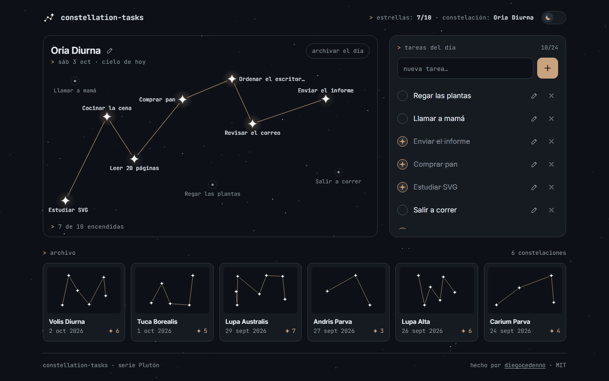

# constellation-tasks

> A to-do list where every task is a star: complete them and they join into the constellation of your day, which is kept in an archive of past skies.
>
> Una lista de tareas donde cada tarea es una estrella: al completarlas se unen en la constelación de tu día, que queda guardada en un archivo de cielos pasados.

**[Live demo · Demo en vivo →](https://diegocedenno.github.io/constellation-tasks/)**

**[English](#english)** · **[Español](#español)**

---

## English

### What it does

- Type a task and press `Enter`: a dim star appears in the sky and a row appears in the list. Both are the same data, always in sync.
- Complete a task from the list or by tapping its star. The star lights up with a flash and a line is drawn to it from the previous one, in the order you completed them. Un-completing a task redraws the path.
- Each day's constellation gets a generated pseudo-Latin name (`Lyra Minor`, `Oria Diurna`…) that you can rename.
- When the date changes — checked on load and when you come back to the tab — yesterday's constellation is archived automatically if it had at least one lit star. Unfinished tasks stay in the new sky. "archivar el día" does the same by hand.
- The archive is a gallery of SVG thumbnails with date, name and star count. Open one to see it large and read-only, or delete it.
- Up to 24 tasks per day, with a friendly notice at the limit. Everything survives a reload (`localStorage`).
- A switch in the header flips between dark and light mode: the same sky redrawn as a star chart on paper, with ink stars joined by sepia lines. The choice is remembered and shared across the Plutón series.

### What makes it technically interesting

- **Deterministic star placement without a grid.** Each star's position comes from Mitchell's best-candidate sampling, seeded by a hash of the task id: out of 28 candidate points it keeps the one farthest from the existing stars. Same id, same spot; 24 stars still keep their distance.
- **Labels that never collide.** A greedy placer tries below, above, right and left of each star and keeps the first slot that does not hit another label, another star, the frame or — when it can be avoided — a constellation line (Liang–Barsky clipping). Labels with no room are dropped and shown in a floating tip on hover or focus. On narrow screens only lit and focused stars carry a label.
- **SVG text that does not shrink.** The sky's `viewBox` always equals its size in CSS pixels, so an 11.5 px label is 11.5 px on a 360 px phone and on a wide monitor. A `ResizeObserver` re-lays everything out.
- **Lines that draw themselves.** New links animate `stroke-dashoffset` with an eased curve through the Web Animations API; the path is keyed by star pair, so only the links that actually changed are redrawn.
- **No animation loop.** Flashes and strokes are one-shot animations; the twinkle is a CSS animation on `opacity` only, paused while the tab is hidden. With `prefers-reduced-motion` everything becomes an opacity fade and ends in the same final state.
- **Accessible SVG.** The list is the main keyboard route (native checkboxes, inline editing). Stars are `role="checkbox"` controls with a roving tabindex: one tab stop for the whole sky, arrow keys jump to the nearest star in that direction, `Enter` or `Space` toggles.
- **Pure, testable model.** Placement, naming, ordering, archiving and day rollover live in one DOM-free file. Stored data is rebuilt field by field on load, so a corrupt or hand-edited `localStorage` entry cannot break the page.
- **Zero dependencies, zero build.** Plain HTML, CSS and JavaScript. Fonts are bundled; nothing is requested from the network.

### Keyboard

| Key | Action |
| --- | --- |
| `Enter` in the text field | Add the task |
| `Space` on a checkbox | Complete / un-complete |
| `←` `→` `↑` `↓` on a star | Jump to the nearest star in that direction |
| `Enter` or `Space` on a star | Light it up / turn it off |
| `Enter` / `Esc` while editing | Save / cancel |
| `Esc` in the archive detail | Close |

### Run it

Double-click `index.html`. That is all — there is no build step and no server.
It also works as-is on GitHub Pages.

### License

[MIT](LICENSE) © Diego Cedeño. Inter and JetBrains Mono are bundled under the [SIL Open Font License](assets/fonts/).

---

## Español

### Qué hace

- Escribe una tarea y pulsa `Enter`: aparece una estrella tenue en el cielo y una fila en la lista. Las dos vistas son los mismos datos, siempre sincronizados.
- Completa una tarea desde la lista o tocando su estrella. La estrella se enciende con un destello y se dibuja un trazo hasta ella desde la anterior, en el orden en que las completaste. Descompletar una tarea rehace el trazo.
- La constelación de cada día recibe un nombre pseudo-latino generado (`Lyra Minor`, `Oria Diurna`…) que puedes cambiar.
- Cuando cambia la fecha —se comprueba al cargar y al volver a la pestaña— la constelación de ayer se archiva sola si tenía al menos una estrella encendida. Las tareas pendientes siguen en el cielo nuevo. "archivar el día" hace lo mismo a mano.
- El archivo es una galería de miniaturas SVG con fecha, nombre y número de estrellas. Abre una para verla en grande, en solo lectura, o bórrala.
- Hasta 24 tareas por día, con un aviso amable al llegar al límite. Todo sobrevive a una recarga (`localStorage`).
- Un interruptor en la cabecera alterna entre modo oscuro y claro: el mismo cielo redibujado como carta estelar sobre papel, con estrellas de tinta unidas por trazos sepia. La elección se recuerda y se comparte entre los proyectos de la serie Plutón.

### Qué lo hace interesante técnicamente

- **Posiciones deterministas sin rejilla.** La posición de cada estrella sale de un muestreo de "mejor candidato" de Mitchell sembrado con un hash del id de la tarea: de 28 puntos posibles se queda con el más alejado de las estrellas que ya hay. Mismo id, mismo sitio; con 24 estrellas siguen guardando distancia.
- **Etiquetas que no se pisan.** Un colocador voraz prueba debajo, encima, a la derecha y a la izquierda de cada estrella y se queda con el primer hueco que no toca otra etiqueta, otra estrella, el borde ni —si se puede evitar— un trazo de la constelación (recorte de Liang–Barsky). Las que no caben se omiten y aparecen en una etiqueta flotante al pasar el cursor o el foco. En pantallas estrechas solo llevan etiqueta las encendidas y la enfocada.
- **Texto SVG que no encoge.** El `viewBox` del cielo mide siempre lo mismo que su caja en píxeles CSS, así que una etiqueta de 11,5 px mide 11,5 px en un móvil de 360 px y en un monitor ancho. Un `ResizeObserver` recoloca todo.
- **Trazos que se dibujan solos.** Los enlaces nuevos animan `stroke-dashoffset` con una curva suavizada mediante la Web Animations API; el camino se indexa por pareja de estrellas, así que solo se redibujan los enlaces que cambiaron de verdad.
- **Sin bucle de animación.** Destellos y trazos son animaciones puntuales; el titileo es una animación CSS solo sobre `opacity`, en pausa con la pestaña oculta. Con `prefers-reduced-motion` todo pasa a ser un fundido de opacidad y termina en el mismo estado final.
- **SVG accesible.** La lista es la vía principal con teclado (casillas nativas, edición en línea). Las estrellas son controles `role="checkbox"` con tabindex itinerante: una sola parada de tabulación para todo el cielo, las flechas saltan a la estrella más cercana en esa dirección y `Enter` o `Espacio` la encienden o apagan.
- **Modelo puro y comprobable.** Posiciones, nombres, orden, archivo y cambio de día viven en un archivo sin DOM. Lo guardado se reconstruye campo a campo al cargar, así que una entrada de `localStorage` corrupta o editada a mano no puede romper la página.
- **Cero dependencias, cero build.** HTML, CSS y JavaScript sin más. Las fuentes van incluidas; no se pide nada a la red.

### Teclado

| Tecla | Acción |
| --- | --- |
| `Enter` en el campo de texto | Añadir la tarea |
| `Espacio` en una casilla | Completar / descompletar |
| `←` `→` `↑` `↓` sobre una estrella | Saltar a la estrella más cercana en esa dirección |
| `Enter` o `Espacio` sobre una estrella | Encenderla / apagarla |
| `Enter` / `Esc` mientras editas | Guardar / cancelar |
| `Esc` en el detalle del archivo | Cerrar |

### Cómo correrlo

Doble clic en `index.html`. Nada más: no hay build ni servidor.
También funciona tal cual en GitHub Pages.

### Licencia

[MIT](LICENSE) © Diego Cedeño. Inter y JetBrains Mono se incluyen bajo la [SIL Open Font License](assets/fonts/).
